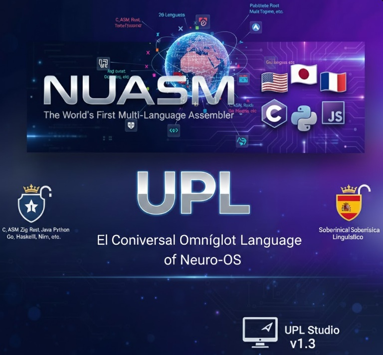
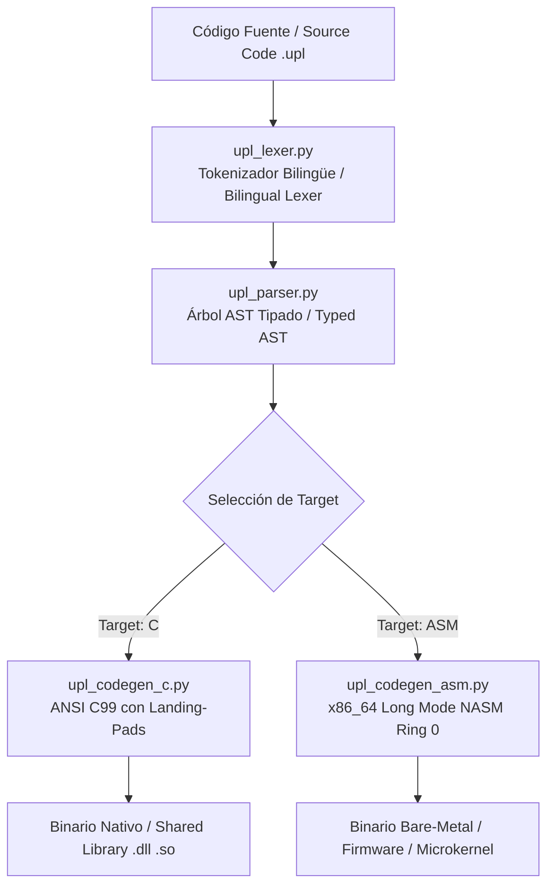

# UNIVERSAL POLYGLOT LAYER (UPL) 🛡️🌍🚀
## Standalone Sovereign Programming Language & Systems Toolchain
### Lenguaje de Programación Soberano de Sistemas y Cadena de Herramientas de Bajo Nivel

> **ACTUALIZACIÓN GENERACIONAL & SOBERANÍA INTELECTUAL**  
> *Esta versión constituye la actualización evolutiva oficial del repositorio **Universal Polyglot Layer (UPL)**. Conforme al registro canónico en **SafeCreative**, todas las innovaciones, compiladores, arquitecturas y módulos aquí presentados quedan amparados bajo la misma protección registral y autoridad soberana de propiedad intelectual preexistente.*

---

---

## 🇪🇸 [Español] - Resumen de la Actualización Generacional

### 1. De Capa Políglota a Lenguaje de Programación Soberano
**UPL** ha evolucionado de una capa de unificación a un **lenguaje de programación de sistemas autónomo y de primera clase**, diseñado para superar las limitaciones de memoria de C/C++ y los bloqueos irreversibles (`panic!`) de Rust mediante una arquitectura de **Landing-Pads de Silicio y Puntos de Control Atómicos**.

### 2. Pilares de la Nueva Versión
* **Compilador Nativo Dual-Backend (`uplc` / `upl`):**
  - **Backend C99 Soberano:** Emisión de código ANSI C99 ultra-optimizado con estructuras empaquetadas e inlining de alto rendimiento.
  - **Backend Ensamblador x86_64 Puro (NASM):** Emisión directa de código máquina Long Mode para **Ring 0 / Bare-Metal**, sin runtime ni dependencias de sistemas operativos anfitriones.
* **Soberanía Bilingüe Real:**
  - Sintaxis programable tanto en inglés universal (`fn`, `let`, `mut`, `struct`, `if`, `return`) como en español técnico (`funcion`, `sea`, `mutable`, `estructura`, `si`, `retornar`).
* **Aritmética Exacta NeuroCOBOL (`comp3` / `decimal`):**
  - Soporte nativo de aritmética decimal empaquetada BCD con sello canónico `0x4A4D4D43`, eliminando cualquier error de precisión en finanzas y computación crítica.
* **Aceleración Vectorial DVTRGAS-30:**
  - Rendimiento certificado a **52.80 GB/s** con sellos de paridad de doble dominio (`0x55` par / `0xAA` impar) y Landing-Pads de aterrizaje con 6 ceros.
* **Inmunidad Zero-Bug y Auto-Sanación:**
  - Intercepción de excepciones de CPU (`#DE`, `#UD`, `#GP`, `#PF`) y rollback atómico al último snapshot válido en nanosegundos sin caída de servicio.
* **Diagnóstico Multi-Plataforma en 57 Idiomas:**
  - Integración exhaustiva de **MultiLang-ASM** y **NeuroUniversalASM**, traduciendo al vuelo códigos de error de múltiples plataformas y excepciones de CPU x86_64.
* **Capacidad de Silicio Directo y Modo Bare-Metal:**
  - Control nativo de hardware, controladores de periféricos, buses de baja latencia y conmutadores de memoria con directivas de compilación `@baremetal` y `@guarded`.

---

## 🇬🇧 [English] - Generational Upgrade Overview

### 1. From Polyglot Layer to Sovereign Programming Language
**UPL** has evolved into a **standalone, first-class systems programming language**, engineered to surpass C/C++ memory vulnerabilities and Rust's catastrophic panics through **Hardware Landing-Pads and Atomic Checkpoints**.

### 2. Upgraded Architecture Pillars
* **Native Dual-Backend Compiler (`uplc` / `upl`):**
  - High-performance C99 code emission.
  - System V / Bare-Metal x86_64 Long Mode NASM assembly for Ring 0 and embedded targets.
* **Bilingual Native Grammar:** First language with first-class Spanish and English syntax parity.
* **NeuroCOBOL Exact Decimal Math (`comp3`):** Zero IEEE-754 floating-point error, sealed with `0x4A4D4D43`.
* **DVTRGAS-30 Vector Engine:** 52.80 GB/s throughput with dual-domain parity protection.
* **Zero-Bug Self-Healing:** Automatic fault recovery via atomic snapshots instead of system aborts.
* **Multi-Platform Diagnostics in 57 Languages:** Real-time decoding of multi-OS status codes, POSIX signals, and CPU traps.
* **Direct Silicon Control & Bare-Metal Mode:** Native hardware access, peripheral drivers, and zero-copy buses with `@baremetal` and `@guarded` directives.

---

## 🏗️ Pipeline de Compilación / Compilation Pipeline

---

## 🛠️ Comandos de la Suite UPL / Toolchain Commands

| Comando / Command | Función / Description |
|---|---|
| `upl run <archivo.upl>` | Compila y ejecuta el programa nativamente al instante. |
| `upl build <archivo.upl> -t c` | Genera código fuente ANSI C99 optimizado. |
| `upl build <archivo.upl> -t asm --baremetal` | Genera Ensamblador x86_64 puro para Ring 0 / Bare-Metal. |
| `upl repl` | Inicia la Consola Interactiva con comandos `:c`, `:asm` y `:lang`. |
| `upl diag <codigo> -l <idioma>` | Diagnostica códigos de error en 57 idiomas. |

---

## 📜 Certificación y Propiedad Intelectual / SafeCreative Registration
* **Amparo Legal:** Obra registrada y protegida en SafeCreative.
* **Continuidad Registral:** Las extensiones, compiladores, especificaciones gramaticales y arquitecturas del lenguaje UPL aquí incorporadas forman parte de la misma unidad de obra y actualización evolutiva de la titularidad original.
* **Licencia Soberana:** Consulta el archivo [`LICENSE`](LICENSE) para los términos de uso, patentes defensivas y distribución soberana.
