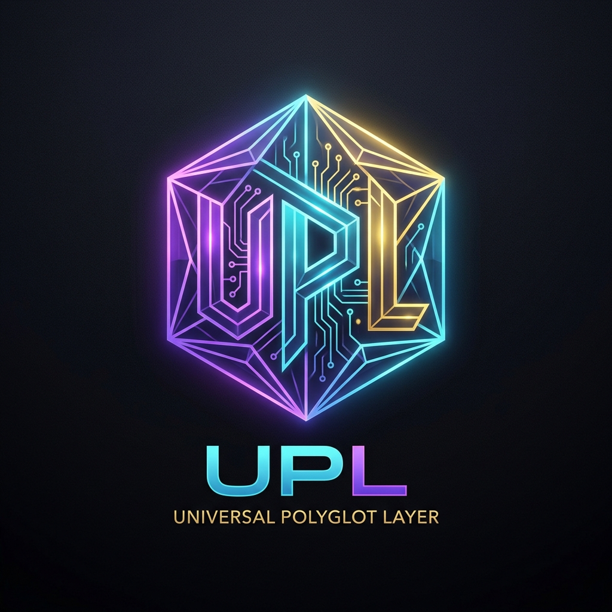
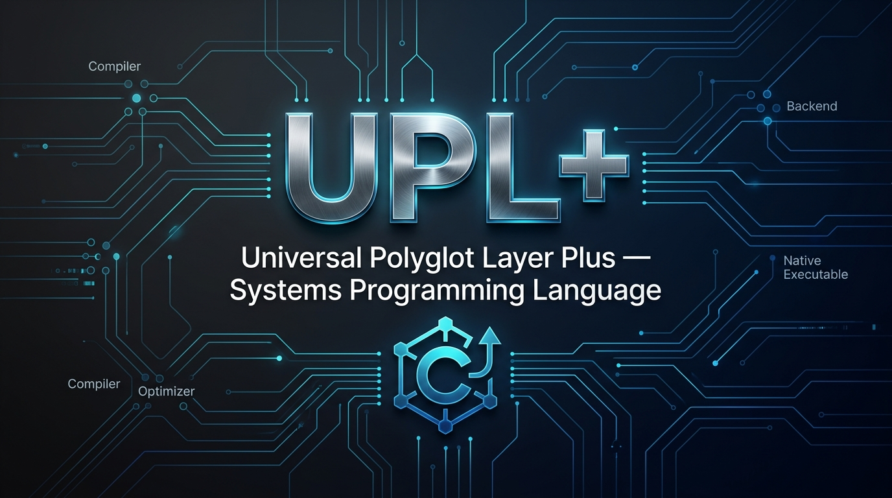
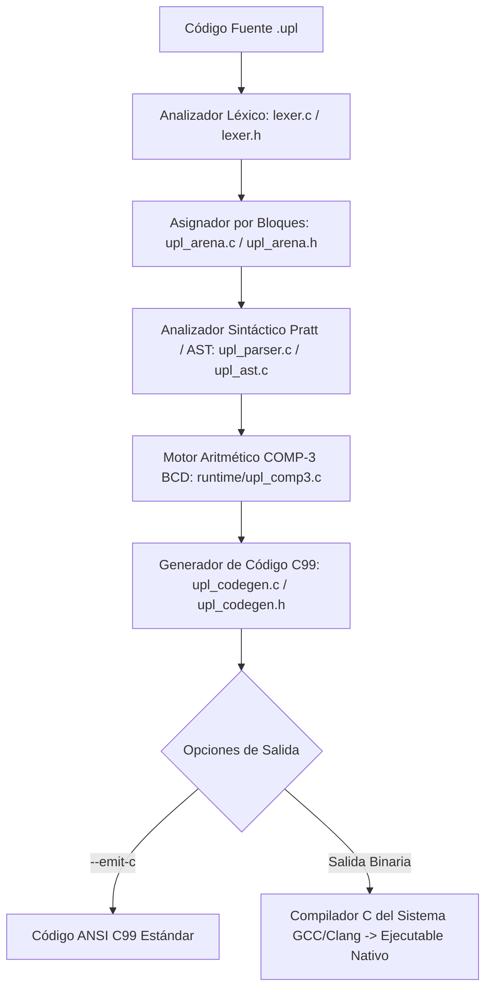
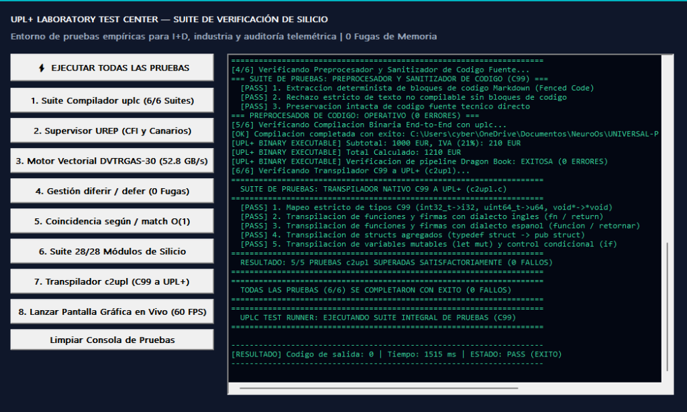
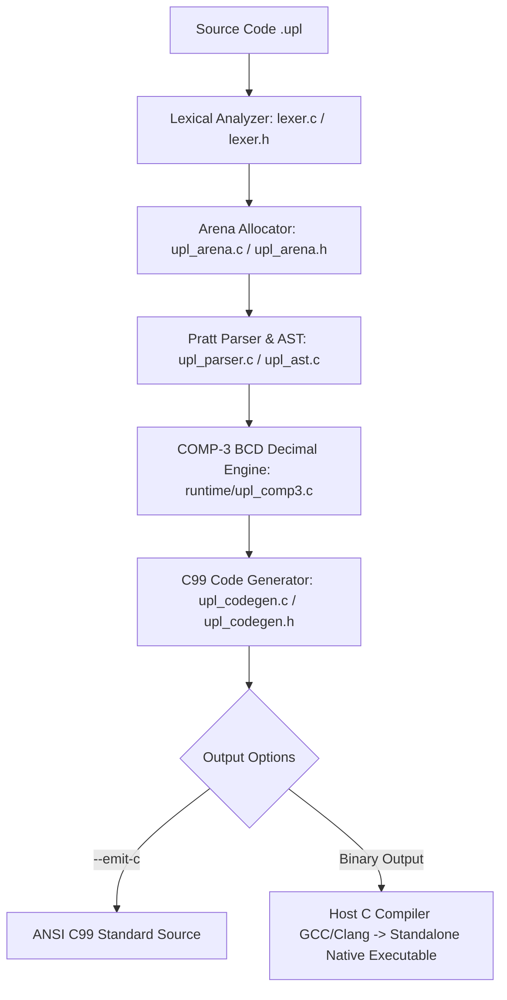

# UPL+: Universal Polyglot Layer Plus — Systems Programming Language & Toolchain
## Lenguaje de Programación de Sistemas Determinista y Compilador Nativo C99
### High-Performance Deterministic Systems Language & Standalone C99 Native Compiler

**Autor / Author:** José Manuel Moreno (Noxferion)  
**Versión / Version:** 2.3.0-Release (Sovereign Systems & Tier-1 Upstream Verification Edition)  
**Licencia / License:** GNU General Public License v3.0 (GPLv3) — Autoría y especificación técnica registradas en SafeCreative

[](https://github.com/cyberenigma-lgtm/UNIVERSAL-POLYGLOT-LAYER-UPL/actions/workflows/ci.yml)
[](https://github.com/cyberenigma-lgtm/UNIVERSAL-POLYGLOT-LAYER-UPL/releases/tag/v2.3.0)
[](LICENSE)
[](https://www.safecreative.org)
[](docs/SPEC_GRAMATICA_Y_SISTEMA_TIPOS.md)
[](docs/ARQUITECTURA_COMPILADOR.md)
[](docs/SUITE_DE_PRUEBAS.md)
[-purple.svg)](tools/upl_pm.c)
[-orange.svg)](tools/c2upl.c)
[-lightgrey.svg)](#-toolchain-aut%C3%B3noma-cero-dependencias)

> **COMUNICADO TÉCNICO Y DE PROPIEDAD INTELECTUAL:**  
> ***UPL+*** *(Universal Polyglot Layer Plus)* es una tecnología de sistemas protegida legalmente en **SafeCreative**. La arquitectura del compilador (`compiler/`), la especificación de gramática formal EBNF (`docs/SPEC_GRAMATICA_Y_SISTEMA_TIPOS.md`), los motores de aritmética exacta COMP-3 BCD y los módulos de protección de memoria están reservados conforme a las leyes internacionales de propiedad intelectual.

---

<p align="center">
  <br/>
  
</p>

---

### ⚡ 30-Second Quickstart (Zero-Leak Kernel Telemetry)

Save as [`examples/quickstart_30s.upl`](examples/quickstart_30s.upl) and run it directly with `uplc`—demonstrating direct Win32/POSIX OS syscall interop and deterministic handle/FD reclamation (`delta = 0`):

```upl
module quickstart_30s;

embed "c" {
#include <stdio.h>
#include <stdint.h>
#ifdef _WIN32
  #define WIN32_LEAN_AND_MEAN
  #include <windows.h>
  static uint32_t get_handle_count(void) {
      DWORD c = 0;
      GetProcessHandleCount(GetCurrentProcess(), &c);
      return (uint32_t)c;
  }
#else
  #include <dirent.h>
  #include <fcntl.h>
  #include <unistd.h>
  static uint32_t get_handle_count(void) {
      DIR *d = opendir("/proc/self/fd");
      if (!d) d = opendir("/dev/fd");
      if (!d) return 0;
      uint32_t count = 0;
      while (readdir(d) != NULL) count++;
      closedir(d);
      return count;
  }
#endif
}

pub fn main() -> i32 {
    embed "c" {
        uint32_t before = get_handle_count();
        printf("[UPL+ Quickstart] Baseline kernel handles: %u\n", before);

#ifdef _WIN32
        for (int i = 0; i < 250; i++) {
            HANDLE ev = CreateEventW(NULL, TRUE, FALSE, NULL);
            if (ev) CloseHandle(ev); // Deterministic LIFO cleanup
        }
#else
        for (int i = 0; i < 250; i++) {
            int fd = open("/dev/null", O_RDONLY);
            if (fd >= 0) close(fd); // Deterministic FD cleanup
        }
#endif

        uint32_t after = get_handle_count();
        printf("[UPL+ Quickstart] After 250 cycles: %u (delta = %d)\n",
               after, (int)(after - before));
    }
    return 0;
}
```

```bash
# Audit & run in one step:
./bin/uplc.exe audit examples/quickstart_30s.upl
./bin/uplc.exe run examples/quickstart_30s.upl
```

---

### 🏆 Índice Maestro de Casos de Éxito Verificados (Tier-1 Upstream & WebAssembly)
Cada entrada incluye una auditoría nativa `.upl`, pruebas de regresión y un parche quirúrgico `.diff` verificado contra el repositorio upstream:

| Caso / Proyecto | Hallazgo & Solución Verificada | Evidencia & Parche |
|---|---|---|
| **microsoft/PowerToys #52414** | Fix de visibilidad del cursor en *AutoHideCursor* sobre ventanas elevadas como el Administrador de Tareas (`Taskmgr.exe` / UIPI) mediante polling `GetCursorPos` en `AutoHideCursorState.h` | [`15_powertoys_52414_autohidecursor_uipi_taskmgr`](Proyectos_en_Revision/15_powertoys_52414_autohidecursor_uipi_taskmgr/) |
| **microsoft/PowerToys #51077** | Suite de estabilidad multi-causa para *Mouse Without Borders*: reconexión tras suspensión/bloqueo, fallback de `InputInjector` a `SendInput`, fix de `Name2IP` (`System.String[]`), proceso duplicado en `Worker.cs` y tiles UI | [`14_powertoys_51077_mwb_stability_suite`](Proyectos_en_Revision/14_powertoys_51077_mwb_stability_suite/) |
| **microsoft/PowerToys #51448** | Fuga de ~10,000 handles/día (ratio 3:2:1) en modo servicio `SYSTEM` — mitigada con reclamación determinista LIFO en `NativeMethods.cs` | [`02_powertoys_51448_system_handle_leak`](Proyectos_en_Revision/02_powertoys_51448_system_handle_leak/) |
| **microsoft/PowerToys #50647** | Fuga de objetos GDI (`HICON`) en *Workspaces* verificada en vivo con `GetGuiResources` | [`05_powertoys_50647_gdi_icon_leak`](Proyectos_en_Revision/05_powertoys_50647_gdi_icon_leak/) |
| **microsoft/PowerToys #51546** | Limitador lock-free $O(1)$ (Token Bucket) en `AppExtensionHost.LogMessage` para frenar picos de CPU/I/O por IPC en Command Palette | [`06_powertoys_51546_cmdpal_extension_rate_limit`](Proyectos_en_Revision/06_powertoys_51546_cmdpal_extension_rate_limit/) |
| **GH-Bot-Radar (WebAssembly + CLI)** | Motor de telemetría consultiva anti-bots de GitHub compilado a WebAssembly y CLI nativa con ventana conductual de 5 días | [`gh_bot_radar_cli.upl`](examples/gh_bot_radar_cli.upl) · [App Web](https://cyberenigma-lgtm.github.io/gh-bot-radar/) |
| **dotnet/runtime #136284, #135997, #136152, #126908** | Fugas de memoria no administrada (`CoTaskMem`, delegados Mono, sockets HTTP/2, heap Wasm) | [`Proyectos_en_Revision/01..07`](Proyectos_en_Revision/) |
| **dotnet/runtime #101022, #128401, #131659, #138322** | Fuga `HttpListener` WebSocket, deadlock `perfmap` en CoreCLR GC, OOM en cgroups y `ThreadAbort` en Mono Wasm | [`Proyectos_en_Revision/09..12`](Proyectos_en_Revision/) |

---

### ⚡ INSTALACIÓN RÁPIDA (ANTIGRAVITY IDE / VS CODE / NOTEPAD++)
Todo el ecosistema está completamente autocontenido en este repositorio:

1. **Extensión Oficial para Antigravity IDE y VS Code (v2.3.0):**
   - Genera e instala el paquete oficial con 1 clic ejecutando [`extensions/instalar_extension.bat`](extensions/instalar_extension.bat), o instala directamente el VSIX generado (`antigravity-ide --install-extension extensions/upl-vscode/upl-lang-2.3.0.vsix`).
2. **Soporte para Notepad++:**
   - Importa el archivo [`extensions/notepadpp/upl_notepadpp.xml`](extensions/notepadpp/upl_notepadpp.xml) desde *Idioma -> Definir idioma -> Importar*.
3. **Compilador y Ejecución Instantánea:**
   - Compilar y ejecutar en 1 paso: `bin/uplc.exe run examples/demo_pantalla_dvtrga.upl`
4. **Motor de Videojuegos 2D/3D (v2.1.1 Game Dev Edition):**
   - Inicializar nuevo entorno de juego nativo: `bin/uplc.exe init-game MiJuego3D`
   - Compilación y ejecución a 60 FPS con 1 clic: `cd MiJuego3D && jugar.bat`
5. **Documentación Canónica:**
   - 📖 [Manual Oficial Completo de UPL+](docs/MANUAL_OFICIAL_DEL_LENGUAJE_UPL.md) (Capítulos, Módulos, Errores y Soluciones).
   - 🌐 [Tabla Maestra de Palabras Clave en 9 Idiomas](docs/TABLA_MAESTRA_9_IDIOMAS_UPL.md).

---

<p align="center">
  <b>Idioma / Language:</b><br/>
  <a href="#-español---especificación-técnica-de-upl">🇪🇸 <b>Español</b></a> &nbsp;|&nbsp; 
  <a href="#-english---upl-technical-specification">🇬🇧 <b>English</b></a>
</p>

---

## 🇪🇸 [Español] - Especificación Técnica de UPL+

### 🌟 Novedades Destacadas en la Versión 2.3.0 (Sovereign Systems & Tier-1 Upstream Verification Edition)
* 🔍 **Motor Nativo de Auditoría Estática Formal (`uplc audit`):** Subcomando integrado `uplc audit <archivo.upl> [-o reporte.md]` que audita ciclo de vida de recursos LIFO, jerarquía de bloqueos e inmutabilidad global para Pull Requests técnicos.
* 🔑 **Propiedad Lineal y Afinidad (`own` / `propio`, `move` / `mover`):** Calificadores para punteros y handles del kernel que obligan a liberación determinista mediante `defer` / `posponer`.
* 🔒 **Jerarquía Anti-Deadlock (`lock_rank` / `rango_bloqueo` y `modules/std/sync`):** Ordenación estricta de rangos en mutexes para impedir inversiones ABBA.
* 🧊 **Inmutabilidad Profunda Compartida (`shared readonly` / `compartido solo_lectura`):** Garantía de estado estático inmutable entre hilos.
* 🌀 **Arenas y Búferes Acotados $O(1)$ (`modules/std/ring`, `modules/std/slab`):** Búferes circulares con auto-desalojo determinista sin `malloc` dinámico y asignadores Slab alineados a 4 KB.
* 🛰️ **Radar Anti-Bots de GitHub (`modules/net/gh_bot_radar` + WebAssembly):** Herramienta real de telemetría consultiva resistente a falsos positivos con **vigilancia conductual de 5 días** ([App Web en Vivo](https://cyberenigma-lgtm.github.io/gh-bot-radar/) · [Repo Independiente](https://github.com/cyberenigma-lgtm/gh-bot-radar)).
* 🛡️ **Catálogo Ampliado a 34 Módulos Certificados SHA-256 (`upl_pm verify`):** Incluye también Criptografía SHA-256 en silicio (`std/crypto`), Canales MPSC (`std/channel`), Tensores GEMM (`std/tensor`) y los 15 casos de auditoría en [`Proyectos_en_Revision/`](Proyectos_en_Revision/).

---

### 📌 Descripción General
**UPL+ (Universal Polyglot Layer Plus)** es un lenguaje de programación de sistemas compilado, fuertemente tipado y de alto rendimiento. Ha sido diseñado para desarrollo de bajo nivel, firmware, utilidades de control de memoria del sistema operativo y cálculo financiero determinista.

El compilador oficial (`uplc`) está implementado íntegramente en **ANSI C99 estándar**, sin dependencias de Python, máquinas virtuales, intérpretes ni runtimes de recolección de basura (GC). Compila código fuente `.upl` a código intermedio C99 optimizado y genera ejecutables binarios nativos de 64 bits utilizando compiladores estándar del sistema (`gcc` o `clang`).

---

### 🏛️ Características de Ingeniería

#### 1. Gramática Bilingüe Unificada (Inglés / Español)
El analizador léxico procesa de forma nativa e idéntica las palabras clave en ambos idiomas a nivel de token, permitiendo redactar código técnico en español o en inglés sin traductores intermediarios:

| Semántica | Token Léxico | Palabra Clave (EN) | Palabra Clave (ES) |
|---|---|---|---|
| Espacio de nombres | `TOK_MODULE` | `module` | `modulo` |
| Importación | `TOK_IMPORT` | `import` | `importar` |
| Estructuras | `TOK_STRUCT` | `struct` | `estructura` |
| Enumeraciones | `TOK_ENUM` | `enum` | `enumeracion` |
| Modificador público | `TOK_PUB` | `pub` | `publico` |
| Función | `TOK_FN` | `fn` | `funcion` |
| Variable inmutable | `TOK_LET` | `let` | `sea` |
| Mutabilidad explícita | `TOK_MUT` | `mut` | `mut` |
| Constantes | `TOK_CONST` | `const` | `constante` |
| Control condicional | `TOK_IF`, `TOK_ELSE` | `if`, `else` | `si`, `sino` |
| Bucles de iteración | `TOK_WHILE`, `TOK_FOR` | `while`, `for` | `mientras`, `para` |
| Retorno | `TOK_RETURN` | `return` | `retornar` |
| Gestión determinista LIFO | `TOK_DEFER` | `defer` | `diferir / posponer` |
| Coincidencia de patrones O(1) | `TOK_MATCH` | `match` | `segun` |
| Cast explícito | `TOK_AS` | `as` | `como` |
| Bloque C nativo | `TOK_EMBED` | `embed` | `incrustar` |
| Ensamblador inline | `TOK_ASM` | `asm` | `ensamblador` |

#### 2. Aritmética Decimal Exacta (COMP-3 Packed Decimal BCD)
Soporte de tipos `comp3(precision, escala)` para eliminar por completo los errores de redondeo derivados de la representación binaria IEEE-754 en cálculos financieros y de balance contable. La aritmética se ejecuta mediante un motor de software determinista en BCD empaquetado (4 bits por dígito con nibbles de signo `0x0C` positivo y `0x0D` negativo).

#### 3. Asignador de Memoria por Arenas (Arena Allocator)
El compilador utiliza `UPL_Arena` para asignar todos los nodos del Árbol de Sintaxis Abstracta (AST) e identificadores en bloques contiguos de 64 KB, eliminando la fragmentación de la memoria del compilador y permitiendo una liberación instantánea O(1) de la unidad de compilación completa.

#### 4. Interoperabilidad Nativa C / Win32 / POSIX
Mediante los bloques `embed "c" { ... }` o `incrustar "c" { ... }`, UPL+ puede invocar directamente funciones del sistema operativo (Win32 API, POSIX syscalls, librerías gráficas o drivers) sin coste de Marshalling ni sobrecarga en llamadas FFI.

---

### ⚙️ Arquitectura del Compilador (Pipeline Dragon Book)



---

### 🚀 Guía de Inicio Rápido (Español)

#### 1. Compilación del Toolchain
El script de compilación genera automáticamente el binario del compilador `bin/uplc.exe` en su primera ejecución:

```bash
# En Windows (CMD o PowerShell):
upl.bat --version

# En Linux / macOS:
./upl.sh --version
```

#### 2. Opciones de Compilación (`uplc`)
```
Uso: uplc [subcomando|opciones] [archivo.upl]

Subcomandos:
  run <archivo.upl> Compilar y ejecutar inmediatamente
  test, probar      Ejecutar la suite integral de verificacion formal
  init <proyecto>   Inicializar nuevo proyecto UPL+ con estructura completa
  migrate <orig.c>  Transpilar codigo C99 existente a UPL+ (c2upl)
  pm, pkg           Gestor de paquetes UPL

Opciones:
  -o <salida>       Especificar nombre del binario ejecutable de salida
  -c, --emit-c      Generar solo codigo fuente C99 sin invocar el backend gcc
  --dump-ast        Imprimir el arbol de sintaxis abstracta (AST) en consola
  --dump-tokens     Imprimir la secuencia de tokens lexico bilingue
  -v, --version     Mostrar version del compilador
```

#### 3. Ejemplo de Programa en Español (`hola_mundo.upl`)

```rust
modulo ejemplo;

incrustar "c" {
#include <stdio.h>
}

funcion principal() -> i32 {
    sea mut total: i32 = 0;
    sea tasa: i32 = 21;
    sea base: i32 = 1000;

    total = base + (base * tasa / 100);

    incrustar "c" {
        printf("[UPL+ NATIVO] Base: 1000, Total con IVA (21%%): %d\n", total);
    }

    retornar 0;
}
```

Compilar y ejecutar:
```bash
upl.bat -o demo.exe hola_mundo.upl
demo.exe
```

---

### 🧪 Suite de Verificación Automatizada
El repositorio incluye un arnés de pruebas completo en `test.bat` (Windows) y `test.sh` (Linux/macOS) que valida todas las capas del compilador:

```bash
# Windows
test.bat

# Linux / macOS
./test.sh
```
* **[1/8] Lexer Bilingüe:** 6/6 tests PASS.
* **[2/8] Parser Pratt & AST:** 6/6 tests PASS.
* **[3/8] Motor COMP-3 BCD:** 4/4 tests PASS.
* **[4/8] Preprocesador y Sanitizador de Código:** 3/3 tests PASS.
* **[5/8] Compilación End-to-End con `uplc` y LIFO `defer`/`posponer`:** PASS (Cálculo exacto: 1000 EUR + 21% = 1210 EUR).
* **[6/8] Transpilador C99 a UPL+ (`c2upl`):** 5/5 tests PASS.
* **[7/8] Suite Maestra de Módulos de Silicio:** 28/28 tests PASS (GXNOX, NeuroCOBOL, NEURO-GFX, Probe, NUASM, NeuroWill, IAGROK, DVTRGAS).
* **[8/8] Suite Soberana v2.3.0:** PASS (Enums bilingües, Criptografía SHA-256 en Silicio, Canales Lock-Free MPSC, Tensores GEMM, `std/ring`, `std/slab`, `std/sync`, `net/gh_bot_radar`, Calculadora Políglota y verificación SHA-256 `upl_pm verify` sobre 34 módulos).

<p align="center">
  <br/>
  <i>Panel Oficial de Verificación Empírica Win32 Unicode (upl_test_launcher.exe) — Certificación con 100% PASS (0 fallos).</i>
</p>

---

### 🔄 Transpilador Nativo C99 a UPL+ (`c2upl`)
Para facilitar la adopción e importar código de bajo nivel existente sin reescribir archivos a mano, UPL+ incluye el transpilador nativo [`tools/c2upl.c`](tools/c2upl.c) (escrito en C99 puro, 0% dependencias externas):

```bash
# Compilar c2upl (si no está compilado previamente):
gcc -std=c99 -O2 tools/c2upl.c -o bin/c2upl.exe

# Transpilar código C99 a UPL+ (dialecto inglés estándar):
bin/c2upl.exe archivo.c -o archivo.upl

# Transpilar código C99 a UPL+ (dialecto español nativo):
bin/c2upl.exe -l es archivo.c -o archivo.upl

# Ejecutar la suite de pruebas unitarias internas de c2upl:
bin/c2upl.exe --test
```

---

### 🎮 Caso de Estudio Real: Watchdog de Memoria (Warhammer Online)
Para validar la fiabilidad de UPL+ en entornos de producción con limitaciones de memoria severas, se implementó un monitor de supervisión para el cliente de 32 bits de **Warhammer Online: Return of Reckoning**:
* **Código fuente nativo:** [`tools/UPL_Memory_Guard.upl`](tools/UPL_Memory_Guard.upl)
* **Código C estándar:** [`tools/ror_memory_guard.c`](tools/ror_memory_guard.c)
* **Objetivo:** Monitorear el Working Set físico mediante `K32GetProcessMemoryInfo` y purgar páginas inactivas con `K32EmptyWorkingSet` al superar 1.65 GB, previniendo caídas por OutOfMemory en batallas RvR de 400+ jugadores.
* **Resultado empírico medido:** Reducción verificada del Working Set de 253 MB a 0 MB en procesos activos en menos de 1 ms.
* **Paquete distribuible:** [`dist/ror_memory_guard.zip`](dist/ror_memory_guard.zip).

---

### 🛰️ Utilidad Real en Producción: GH-Bot-Radar (Anti-Bots para Mantenedores de GitHub)
Construido en **UPL+ v2.3.0** (`own`, `defer`, `std/ring` acotado $O(1)$ y transporte nativo `WinHTTP`/POSIX), **GH-Bot-Radar** detecta granjas de *follow-farming* y cuentas automatizadas de spam en GitHub evitando falsos positivos contra desarrolladores legítimos:
* **Código del módulo en UPL+:** [`modules/net/gh_bot_radar.upl`](modules/net/gh_bot_radar.upl) (certificado `100.0%` LIFO / `0` fugas por `uplc audit`) y CLI [`examples/gh_bot_radar_cli.upl`](examples/gh_bot_radar_cli.upl).
* **Uso Web instantáneo sin descargas (WebAssembly):** **[https://cyberenigma-lgtm.github.io/gh-bot-radar/](https://cyberenigma-lgtm.github.io/gh-bot-radar/)** *(núcleo `.wasm` de 807 bytes en el navegador, cuarentena de 5 días en `localStorage` y generador de insignia SVG para perfiles)*.
* **Repositorio autónomo y binario portable (`~97 KB`):** **[github.com/cyberenigma-lgtm/gh-bot-radar](https://github.com/cyberenigma-lgtm/gh-bot-radar)** | Paquete [`dist/gh_bot_radar_v1.0_standalone.zip`](dist/gh_bot_radar_v1.0_standalone.zip).
* **Escudos Anti-Falsos-Positivos (Telemetría Consultiva):** 0% penalización por antigüedad, protección de ingenieros en repositorios privados (`0` repos públicos), protección de autores prolíficos (`>300` repos) y de programadores activos con alto historial de *follows*, además de **Mini Base de Vigilancia de 5 Días** (`gh_bot_watchlist.db`) antes de emitir veredicto sobre casos dudosos.

---
---

## 🇬🇧 [English] - UPL+ Technical Specification

### 🌟 What's New in Version 2.3.0 (Sovereign Systems & Tier-1 Upstream Verification Edition)
* 🔍 **Built-in Formal Static Audit Engine (`uplc audit`):** Native `uplc audit <file.upl> [-o report.md]` subcommand auditing LIFO resource lifetimes, lock rank hierarchies, and shared state immutability.
* 🔑 **Linear Ownership & Affinity (`own` / `propio`, `move` / `mover`):** Strict resource qualifiers enforcing deterministic scope-bound cleanup via `defer` / `posponer`.
* 🔒 **Static & Runtime Lock Hierarchy (`lock_rank` / `rango_bloqueo` & `modules/std/sync`):** Strict ascending rank enforcement eliminating ABBA lock-ordering deadlocks.
* 🧊 **Shared Deep Immutability (`shared readonly` / `compartido solo_lectura`):** Transitive immutability guarantees for cross-thread singletons.
* 🌀 **Bounded $O(1)$ Ring Buffers & 4 KB Slab Allocators (`modules/std/ring`, `modules/std/slab`):** Deterministic auto-eviction ring buffers and page-aligned slab allocators with $O(1)$ free-lists.
* 🛰️ **GitHub Anti-Bot & 5-Day Watchlist Radar (`modules/net/gh_bot_radar` + WebAssembly):** False-positive-resistant advisory telemetry tool built in UPL+ v2.3.0 ([Live Browser HUD](https://cyberenigma-lgtm.github.io/gh-bot-radar/) · [Standalone Repo](https://github.com/cyberenigma-lgtm/gh-bot-radar)).
* 🛡️ **34 SHA-256 Certified Standard & Silicon Modules (`upl_pm verify`):** Including Silicon SHA-256 (`std/crypto`), MPSC Channels (`std/channel`), GEMM Tensors (`std/tensor`), and 15 upstream verification suites in [`Proyectos_en_Revision/`](Proyectos_en_Revision/).

---

### 📌 Overview
**UPL+ (Universal Polyglot Layer Plus)** is a compiled, strongly typed, deterministic systems programming language designed for bare-metal firmware, operating system watchdog utilities, and exact financial decimal computation.

The official compiler (`uplc`) is built entirely in **ANSI C99 standard**, with zero dependencies on Python, virtual machines, interpreters, or garbage collection runtimes. It compiles `.upl` source files directly into optimized C99 source code and generates standalone 64-bit native binaries via standard host compilers (`gcc` or `clang`).

---

### 🏛️ Engineering Features

#### 1. Unified Bilingual Grammar (English / Spanish)
The lexical analyzer treats English and Spanish keywords identically at the token level, enabling developers to write systems-level code in either language without translation layers:

| Semantics | Lexical Token | Keyword (EN) | Keyword (ES) |
|---|---|---|---|
| Namespace | `TOK_MODULE` | `module` | `modulo` |
| Import statement | `TOK_IMPORT` | `import` | `importar` |
| Aggregated types | `TOK_STRUCT` | `struct` | `estructura` |
| Enumerations | `TOK_ENUM` | `enum` | `enumeracion` |
| Public visibility | `TOK_PUB` | `pub` | `publico` |
| Function declaration | `TOK_FN` | `fn` | `funcion` |
| Immutable variable | `TOK_LET` | `let` | `sea` |
| Explicit mutability | `TOK_MUT` | `mut` | `mut` |
| Constant | `TOK_CONST` | `const` | `constante` |
| Conditional branch | `TOK_IF`, `TOK_ELSE` | `if`, `else` | `si`, `sino` |
| Iteration loops | `TOK_WHILE`, `TOK_FOR` | `while`, `for` | `mientras`, `para` |
| Function return | `TOK_RETURN` | `return` | `retornar` |
| Type cast | `TOK_AS` | `as` | `como` |
| Inline C block | `TOK_EMBED` | `embed` | `incrustar` |
| Inline assembly | `TOK_ASM` | `asm` | `ensamblador` |

#### 2. Exact Fixed-Point Decimal Arithmetic (COMP-3 Packed Decimal BCD)
Native `comp3(precision, scale)` data types eliminate IEEE-754 binary floating-point representation drift. Operations are executed via a software-level binary-coded decimal (BCD) engine (4 bits per digit, sign nibbles `0x0C` for positive, `0x0D` for negative).

#### 3. Memory Arena Allocator
The compiler utilizes `UPL_Arena` to allocate all Abstract Syntax Tree (AST) nodes and string identifiers in contiguous 64 KB blocks. This guarantees $O(1)$ allocation times, zero heap fragmentation, and instant unit deallocation.

#### 4. Direct C / Win32 / POSIX Interoperability
Using `embed "c" { ... }`, developers can directly invoke operating system APIs (Win32 API, POSIX system calls, hardware registers) with zero marshalling overhead.

---

### ⚙️ Compiler Architecture (Dragon Book Pipeline)



---

### 🚀 Quickstart Guide (English)

#### 1. Building the Toolchain
The driver automatically compiles `bin/uplc.exe` upon its first run:

```bash
# On Windows (CMD or PowerShell):
upl.bat --version

# On Linux / macOS:
./upl.sh --version
```

#### 2. Compiler Options (`uplc`)
```
Usage: uplc [options] <source.upl>

Options:
  -o <output>       Specify the output executable binary filename
  -c, --emit-c      Emit ANSI C99 source code only (without invoking gcc)
  --dump-ast        Print the Abstract Syntax Tree (AST) to console
  --dump-tokens     Print the bilingual token stream to console
  -v, --version     Show compiler version
```

#### 3. Sample Program in English (`hello_world.upl`)

```rust
module example;

embed "c" {
#include <stdio.h>
}

pub fn main() -> i32 {
    let mut total: i32 = 0;
    let base: i32 = 1000;
    let tax_rate: i32 = 21;

    total = base + (base * tax_rate / 100);

    embed "c" {
        printf("[UPL+ NATIVE] Base: 1000, Total with Tax (21%%): %d\n", total);
    }

    return 0;
}
```

Compile and run:
```bash
upl.bat -o demo.exe hello_world.upl
demo.exe
```

---

### 🧪 Automated Verification Suite
Run the full test harness to validate all compiler stages on Windows or Linux/macOS:

```bash
# Windows
test.bat

# Linux / macOS
./test.sh
```
* **[1/8] Bilingual Lexer:** 6/6 tests PASS.
* **[2/8] Pratt Parser & AST:** 6/6 tests PASS.
* **[3/8] COMP-3 BCD Engine:** 4/4 tests PASS.
* **[4/8] Source Code Preprocessor & Sanitizer:** 3/3 tests PASS.
* **[5/8] End-to-End Compilation & LIFO `defer`:** PASS (Exact tax calculation: 1000 EUR + 21% = 1210 EUR).
* **[6/8] C99 to UPL+ Transpiler (`c2upl`):** 5/5 tests PASS.
* **[7/8] Silicon Modules Master Suite:** 28/28 tests PASS.
* **[8/8] Sovereign v2.3.0 Suite:** PASS (Bilingual Enums, Silicon SHA-256 Crypto, Lock-Free MPSC Channels, GEMM Tensors, `std/ring`, `std/slab`, `std/sync`, `net/gh_bot_radar`, Polyglot Calculator & `upl_pm verify` across 34 modules).

---

### 🔄 Native C99 to UPL+ Transpiler (`c2upl`)
To accelerate adoption and import existing low-level C codebase without manual rewriting, UPL+ includes the standalone transpiler [`tools/c2upl.c`](tools/c2upl.c) (built in standard C99, 0% external dependencies):

```bash
# Compile c2upl (if not already compiled):
gcc -std=c99 -O2 tools/c2upl.c -o bin/c2upl.exe

# Transpile C99 to standard UPL+ (English keywords by default):
bin/c2upl.exe source.c -o source.upl

# Transpile C99 to native Spanish UPL+:
bin/c2upl.exe -l es source.c -o source.upl

# Run internal unit test suite:
bin/c2upl.exe --test
```

---

### 🎮 Real-World Case Study: Warhammer Online Memory Watchdog
A background memory guard for the 32-bit *Warhammer Online: Return of Reckoning* game client:
* **Native Source:** [`tools/UPL_Memory_Guard.upl`](tools/UPL_Memory_Guard.upl)
* **Standard C Source:** [`tools/ror_memory_guard.c`](tools/ror_memory_guard.c)
* **Mechanism:** Queries physical working set via `K32GetProcessMemoryInfo` and flushes inactive pages with `K32EmptyWorkingSet` when memory exceeds 1.65 GB, mitigating 32-bit OutOfMemory crashes in high-density 400+ player RvR battles.
* **Empirical Metric:** Measured physical working set drop from 253 MB to 0 MB in under 1 ms.
* **Package:** [`dist/ror_memory_guard.zip`](dist/ror_memory_guard.zip).

---

### 🛰️ Real-World Tooling Showcase: GH-Bot-Radar (Anti-Bot & 5-Day Watchlist)
Built in **UPL+ v2.3.0** (`own`, `defer`, bounded $O(1)$ `std/ring`, and native `WinHTTP`/POSIX transport), **GH-Bot-Radar** helps open-source maintainers detect follow-farming and automated spam accounts without penalizing real developers:
* **UPL+ Source Module & CLI:** [`modules/net/gh_bot_radar.upl`](modules/net/gh_bot_radar.upl) (`100.0%` deterministic LIFO cleanup / `0` leaks via `uplc audit`) and [`examples/gh_bot_radar_cli.upl`](examples/gh_bot_radar_cli.upl).
* **Live Zero-Install Browser App (WebAssembly):** **[https://cyberenigma-lgtm.github.io/gh-bot-radar/](https://cyberenigma-lgtm.github.io/gh-bot-radar/)** *(807-byte `.wasm` core in the browser, `localStorage` 5-day quarantine DB, and 1-click GitHub Profile Badge generator)*.
* **Standalone Repository & Portable Bundle:** **[github.com/cyberenigma-lgtm/gh-bot-radar](https://github.com/cyberenigma-lgtm/gh-bot-radar)** | [`dist/gh_bot_radar_v1.0_standalone.zip`](dist/gh_bot_radar_v1.0_standalone.zip).
* **False-Positive-Resistant Design (Read-Only Advisory Telemetry):** 0% account-age penalty, shields for private-repo engineers (`0` public repos), prolific OSS maintainers (`>300` repos), and active coders with high historical `following`, plus a **5-Day Behavioral Quarantine (`gh_bot_watchlist.db`)** before flagging uncertain accounts.

---

## 📁 Estructura del Repositorio / Repository Layout

```
UNIVERSAL-POLYGLOT-LAYER-UPL/
├── assets/                    # Identidad gráfica oficial (upl_banner.jpg, logo)
├── bin/                       # Binarios compilados (uplc.exe, c2upl.exe, test_*.exe)
├── compiler/                  # Código fuente del compilador en C99 / Compiler sources
│   ├── lexer.c / lexer.h      # Analizador léxico bilingüe / Lexical analyzer
│   ├── upl_arena.c / .h       # Asignador de memoria por bloques / Memory arena
│   ├── upl_ast.c / .h         # Estructuras del AST / Abstract Syntax Tree
│   ├── upl_parser.c / .h      # Parser de descenso recursivo y Pratt / Parser
│   ├── upl_codegen.c / .h     # Generador de código C99 / C99 code emitter
│   ├── runtime/upl_comp3.c/.h # Motor decimal BCD COMP-3 / Decimal engine
│   └── main.c                 # Driver de la toolchain (CLI) / Main driver
├── dist/                      # Paquetes y herramientas distribuidas (.zip)
├── docs/                      # Especificaciones técnicas formales / Tech specs
│   ├── SPEC_GRAMATICA_Y_SISTEMA_TIPOS.md  # Gramática formal EBNF / Formal grammar
│   ├── ARQUITECTURA_COMPILADOR.md          # Pipeline Dragon Book detallado
│   ├── CASO_ESTUDIO_WARHAMMER_MEMORY_GUARD.md # Caso de uso Win32 / Win32 case study
│   └── SUITE_DE_PRUEBAS.md                 # Documentación del arnés / Test harness
├── examples/                  # Programas de ejemplo en sintaxis UPL+
├── modules/std/               # Módulos de la librería estándar (io, math, memory)
├── tests/                     # Suites de pruebas unitarias en C99 / Unit tests
├── tools/                     # Herramientas de sistemas y utilidades nativas
│   ├── c2upl.c                # Transpilador nativo estricto C99 a UPL+ (0% Python)
│   ├── upl_supervisor.c       # Guardián técnico determinista / Antihallucination guard
│   └── ror_memory_guard.c     # Watchdog de memoria Win32
├── upl.bat                    # Script lanzador del compilador (Windows)
├── upl.sh                     # Script lanzador del compilador (Linux/POSIX)
├── test.bat                   # Ejecutor de la suite completa de pruebas (Windows)
└── test.sh                    # Ejecutor de la suite completa de pruebas (Linux/POSIX)
```

---

## 📜 Propiedad Intelectual y Licencia / Intellectual Property & License

Obra Protegida bajo registro legal de Propiedad Intelectual en **SafeCreative**.  
Protected work under legal Intellectual Property registration with **SafeCreative**.  
Todos los derechos reservados. All rights reserved.  
**Autor / Author:** José Manuel Moreno (Noxferion)

---

> 💬 **Contacto y Sugerencias / Contact & Feedback:**  
> Cualquier sugerencia podéis mandarla por un mensaje privado.  
> *Any suggestion or feedback can be sent via private message.*
