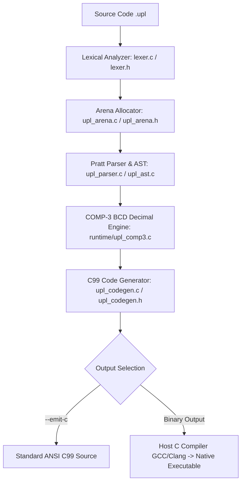

# ⚙️ UPL+ COMPILER ARCHITECTURE (`uplc`)
## Modular Dragon Book Pipeline in ANSI C99

The UPL+ compiler (`uplc`) is located in the [`compiler/`](../../compiler/) source directory and compiles as a standalone executable in [`bin/uplc.exe`](../../bin/uplc.exe) (Windows) or `./bin/uplc` (Linux/POSIX), with zero runtime dependencies and zero virtual machine overhead.

---

### 1. The 7-Phase Compilation Pipeline



1. **Bilingual Lexical Analyzer (`compiler/lexer.c`):**
   - Scans UTF-8 streams and emits typed tokens (`Token`).
   - Identically maps English and Spanish keywords (`fn`/`funcion`, `let`/`sea`, `import`/`importar`, `while`/`mientras`, etc.).
   - Captures raw code blocks (`embed "c" { ... }`) preserving preprocessor directives, Win32 API calls, and POSIX syscalls.
2. **Memory Arena Allocator (`compiler/upl_arena.c`):**
   - Allocates all AST nodes and identifiers in contiguous 64 KB blocks with $O(1)$ complexity and zero memory fragmentation.
3. **Abstract Syntax Tree (`compiler/upl_ast.c`):**
   - Models modules, functions, aggregated structs, control flow statements, and typed expressions.
4. **Recursive-Descent & Pratt Parser (`compiler/upl_parser.c`):**
   - Implements recursive descent for statements and Pratt's operator precedence climbing algorithm for arithmetic and boolean expressions.
5. **COMP-3 Packed Decimal Math Engine (`compiler/runtime/upl_comp3.c`):**
   - Exact software BCD arithmetic for financial and high-precision computing without IEEE-754 drift.
6. **ANSI C99 Code Generator (`compiler/upl_codegen.c`):**
   - Emits clean, strict ISO/IEC 9899:1999 C99 source code with verbatim embedded block injection.
7. **Compilation Driver (`compiler/main.c`):**
   - CLI orchestrator that coordinates phases and invokes the host C compiler (GCC/Clang) to produce the final native binary.

---

### 2. Command-Line Options

```bash
# Compile directly to a standalone native binary:
upl.bat -o program.exe source.upl

# Emit only the equivalent C99 source code:
upl.bat -c source.upl

# Dump the Abstract Syntax Tree (AST):
upl.bat --dump-ast source.upl

# Dump the token stream:
upl.bat --dump-tokens source.upl

# Run the complete compiler test suite:
test.bat
```
