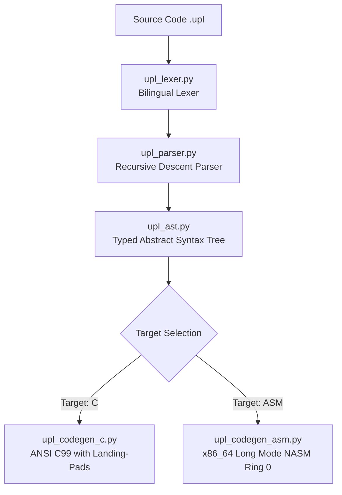

# ⚙️ UPL COMPILER ARCHITECTURE (`uplc`)
## Pipeline Overview, Dual-Backend Code Generation & Self-Healing

---

### 1. The 4-Stage Compilation Pipeline

The sovereign compiler located in [`compiler/`](../../compiler) follows a deterministic pipeline:

1. **Bilingual Lexer (`upl_lexer.py`):** Tokenizes source characters into strongly-typed tokens, handling `@` directives, hex literals, raw `asm { ... }` blocks, and `embed <lang> { ... }`.
2. **Parser & AST (`upl_parser.py` & `upl_ast.py`):** Builds a typed Abstract Syntax Tree enforcing immutability by default, static types, and operator precedence.
3. **C99 Generator (`upl_codegen_c.py`):** Generates clean, standard ANSI C99 with packed structures and inlining, compatible with GCC, Clang, and MSVC.
4. **Assembly Generator (`upl_codegen_asm.py`):** Generates pure x86_64 Long Mode NASM assembly for **Ring 0 / Bare-Metal** execution directly on the CPU without any host OS dependencies.

---

### 2. Resilience: UPL vs. Rust and C++

| Feature | Rust | UPL (Universal Polyglot Layer) |
|---|---|---|
| **Driver / Bare-Metal Code** | Forces `unsafe { ... }`, abandoning safety guarantees. | First-class `@baremetal` with hardware Landing-Pads. |
| **Response to Unexpected Faults** | Executes `panic!`, aborts the process, or crashes the machine. | **Self-Healing:** Intercepts faults and rolls back to last `@snapshot` in nanoseconds. |
| **Critical Math Accuracy** | IEEE 754 floats subject to precision loss. | **NeuroCOBOL (`comp3`):** Exact decimal BCD arithmetic sealed with `0x4A4D4D43`. |
