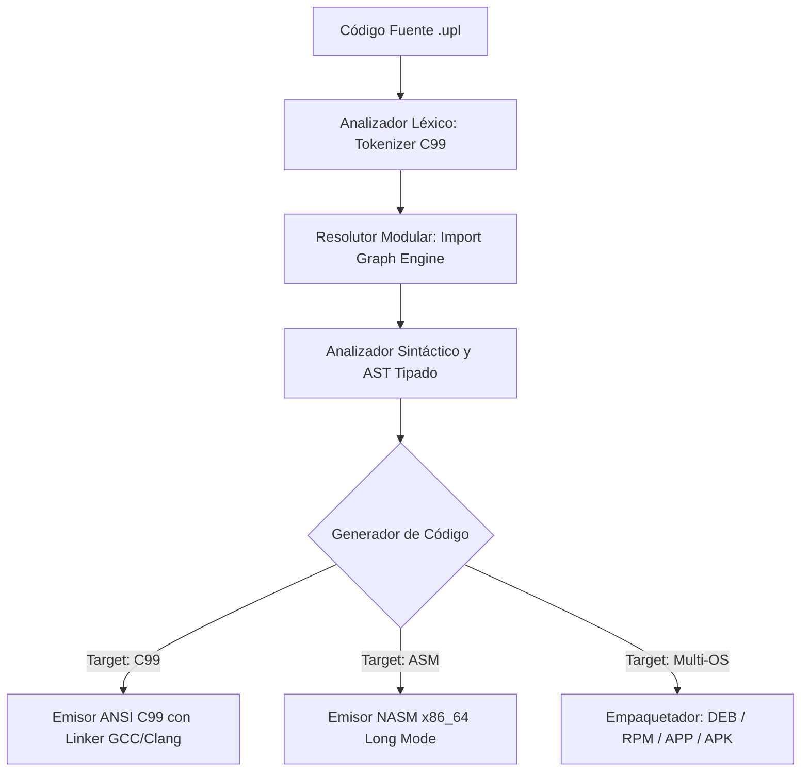

# ⚙️ ARQUITECTURA DEL COMPILADOR UPL (`uplc`)
## Pipeline de Compilación, Generación de Código y Seguridad de Memoria Nativa

El compilador de UPL reside en el archivo fuente nativo [`compiler/uplc.c`](../../compiler/uplc.c) y se compila como un ejecutable autónomo en [`bin/uplc.exe`](../../bin/uplc.exe) (Windows) o `./bin/uplc` (Linux/POSIX), sin dependencias de runtimes o intérpretes externos.

---

### 1. El Pipeline de Compilación en 4 Fases

1. **Analizador Léxico Bilingüe (`compiler/uplc.c`):**
   - Escanea el flujo de caracteres UTF-8 y emite tokens tipados (`Token`).
   - Mapea de forma transparente e idéntica palabras clave en Español e Inglés (`fn`/`funcion`, `let`/`sea`, `import`/`importar`, `while`/`mientras`, etc.).
   - Reconoce decoradores de sistemas (`@snapshot`, `@baremetal`, `@pure`).
2. **Motor de Resolución Modular (`read_and_resolve_source`):**
   - Analiza directivas `import <modulo>;` y resuelve recursivamente las dependencias desde las rutas estándar (`modules/urep/`, `modules/compute/`, `modules/emulator/`, `modules/multilang_asm/`).
   - Previene ciclos de inclusión y fusiona definiciones de estructuras y funciones en una unidad de traducción unificada.
3. **Emisor ANSI C99 (`transpile_upl_to_c`):**
   - Transpila las estructuras y funciones UPL a código C99 conforme con la norma ISO/IEC 9899:1999.
   - Enlaza automáticamente con bibliotecas de cálculo matemático (`-lm`) y primitivas de consola Win32/POSIX.
4. **Emisor Ensamblador NASM x86_64 (`transpile_upl_to_nasm`):**
   - Genera ensamblador canónico de 64 bits optimizado con convención de llamada estándar y alineación de pila de 16 bytes.
5. **Empaquetador Multi-Distribución:**
   - Soporte nativo para empaquetado multi-target mediante la opción `-t` (`deb`, `rpm`, `app`, `apk`).

---

### 2. Mecanismos de Seguridad e Integridad de Memoria

* **Control Flow Integrity (CFI):** Mediante el módulo `modules/urep/urep_guard.upl`, se verifica que el puntero de instrucción (RIP) permanezca estrictamente dentro de los límites de la sección `.text` (`[text_base, text_limit]`).
* **Canarios de Límite de Estructuras (`@snapshot`):** En estructuras marcadas con el decorador `@snapshot`, el compilador inyecta automáticamente bytes de guarda de cabecera (`_guard_canary_head`) y cola (`_guard_canary_tail`), permitiendo la detección de desbordamientos de búfer en memoria adyacente.
* **Aritmética de Punto Fijo (`comp3`):** Proporciona almacenamiento en formato decimal empaquetado (BCD) para operaciones financieras o de misión crítica que requieran precisión exacta sin errores de redondeo IEEE 754.

---

### 3. Modos de Uso del Compilador CLI

El compilador ofrece comandos unificados mediante `upl.bat` (Windows), `upl.sh` (POSIX) o directamente `./bin/uplc`:

* **`upl run <archivo.upl>`**: Compila en memoria y ejecuta el programa inmediatamente.
* **`upl build <archivo.upl> -o <binario.exe>`**: Genera el binario ejecutable optimizado.
* **`upl build <archivo.upl> -t c`**: Exporta el código C99 equivalente.
* **`upl build <archivo.upl> -t asm`**: Exporta el ensamblador NASM x86_64.
* **`upl build <archivo.upl> -t deb|rpm|app|apk`**: Empaqueta el programa para la plataforma seleccionada.
* **`upl list`**: Lista los módulos de sistemas registrados en el ecosistema.
* **`upl test`**: Ejecuta la suite de verificación continua automatizada (18/18 tests).
