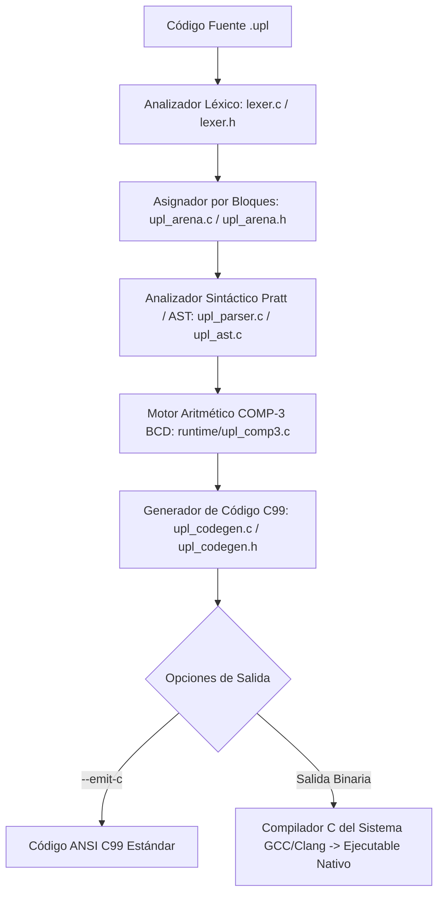

# ⚙️ ARQUITECTURA DEL COMPILADOR UPL+ (`uplc`)
## Pipeline Modular Dragon Book en ANSI C99

El compilador de UPL+ (`uplc`) reside en el directorio fuente [`compiler/`](../../compiler/) y se compila como un ejecutable autónomo en [`bin/uplc.exe`](../../bin/uplc.exe) (Windows) o `./bin/uplc` (Linux/POSIX), sin dependencias de runtimes externos ni máquinas virtuales.

---

### 1. El Pipeline de Compilación en 7 Fases



1. **Analizador Léxico Bilingüe (`compiler/lexer.c`):**
   - Escanea el flujo UTF-8 y emite tokens tipados (`Token`).
   - Mapea de forma idéntica palabras clave en Español e Inglés (`fn`/`funcion`, `let`/`sea`, `import`/`importar`, `while`/`mientras`, etc.).
   - Captura bloques de código crudo (`embed "c" { ... }`) preservando directivas de preprocesador y llamadas Win32/POSIX.
2. **Asignador de Memoria por Arenas (`compiler/upl_arena.c`):**
   - Asigna todos los nodos del AST e identificadores en bloques contiguos de 64 KB con complejidad $O(1)$ y cero fragmentación.
3. **Árbol de Sintaxis Abstracta (`compiler/upl_ast.c`):**
   - Modela declaraciones, funciones, estructuras agregadas, sentencias de control y expresiones.
4. **Analizador Sintáctico y Pratt Parsing (`compiler/upl_parser.c`):**
   - Implementa descenso recursivo para sentencias y precedencia de operadores mediante algoritmo de Pratt para expresiones aritméticas y lógicas.
5. **Motor Aritmético Decimal COMP-3 (`compiler/runtime/upl_comp3.c`):**
   - Aritmética BCD empaquetada en software para cálculos financieros sin errores de redondeo IEEE-754.
6. **Emisor ANSI C99 (`compiler/upl_codegen.c`):**
   - Emite código C99 estricto conforme a ISO/IEC 9899:1999 con preservación de bloques nativos.
7. **Driver de Compilación (`compiler/main.c`):**
   - Orquesta el proceso e invoca a GCC/Clang para generar el ejecutable binario final.

---

### 2. Opciones de Uso de la Línea de Comandos

```bash
# Compilar directamente a binario nativo:
upl.bat -o programa.exe codigo.upl

# Generar únicamente el código fuente C99 equivalente:
upl.bat -c codigo.upl

# Inspeccionar el árbol sintáctico (AST):
upl.bat --dump-ast codigo.upl

# Inspeccionar la secuencia de tokens:
upl.bat --dump-tokens codigo.upl

# Ejecutar el arnés completo de pruebas del compilador:
test.bat
```
