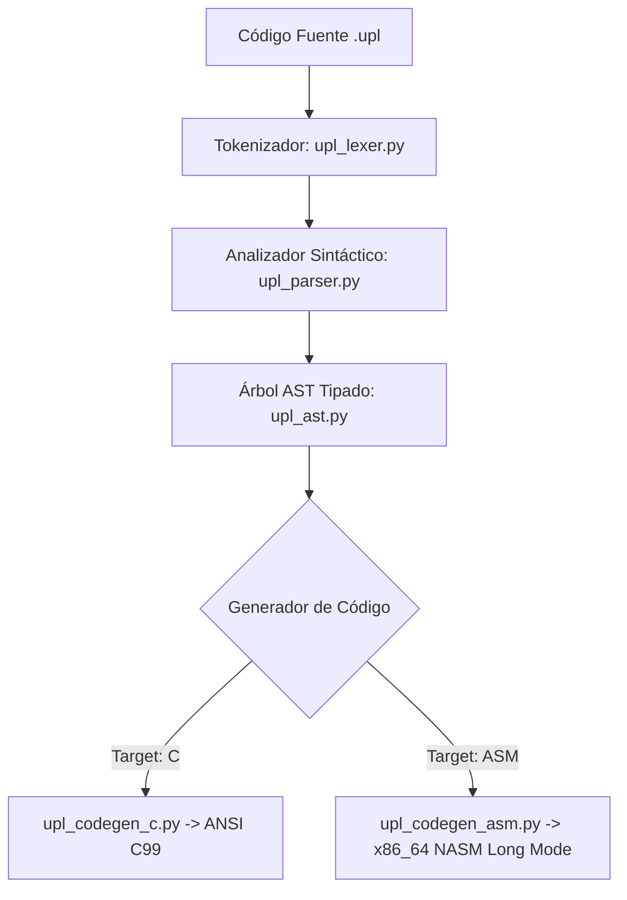

# ⚙️ ARQUITECTURA DEL COMPILADOR UPL (`uplc`)
## Pipeline de Compilación, Generación de Código y Silicon Landing-Pads

---

### 1. El Pipeline en 4 Fases

El compilador de UPL reside en el módulo [`compiler/`](../../compiler) y procesa el código fuente a través de cuatro etapas rigurosas:

1. **Tokenizador Bilingüe (`upl_lexer.py`):** Clasifica los caracteres del código fuente en tokens léxicos tipados, procesa directivas `@`, constantes hexadecimales y extrae bloques inline `asm { ... }` y `embed { ... }`.
2. **Parser y AST (`upl_parser.py` y `upl_ast.py`):** Construye un árbol de sintaxis abstracta con validación de tipos, precedencia matemática de operadores e inmutabilidad estricta.
3. **Generador ANSI C99 (`upl_codegen_c.py`):** Emite código C estándar con estructuras empaquetadas, prototipos seguros y compatibilidad universal con GCC, Clang y MSVC.
4. **Generador Ensamblador x86_64 NASM (`upl_codegen_asm.py`):** Emite código máquina puro en Long Mode (64 bits) para **Ring 0 / Bare-Metal**, ideal para arrancar directamente en CPUs físicas o máquinas virtuales como QEMU sin ningún sistema operativo debajo.

---

### 2. Los Pilares de Seguridad de UPL frente a Rust y C++

* **El Problema de Rust:** Cuando Rust se enfrenta a un error irrecuperable en producción, invoca `panic!`, mata el proceso y provoca la caída del servicio. Además, en controladores y kernels obliga a usar `unsafe { ... }`, perdiendo sus protecciones.
* **La Solución de UPL (Landing-Pads y Auto-Sanación):**
  1. Cada bloque de datos crítico se delimita con un **Landing-Pad DVTRGAS-30** con sello canónico `0xAA30`.
  2. Si ocurre una alteración de memoria o un error de hardware, el Landing-Pad intercepta la desviación y ejecuta un **Rollback Atómico** al último `@snapshot` válido.
  3. El sistema **nunca se cuelga** y recupera su estado seguro en nanosegundos.

---

### 3. Modos de Uso del Compilador CLI

El compilador dispone de comandos unificados 100% nativos mediante `upl.bat` (Windows) y `upl.sh` (Linux/POSIX), o directamente `./bin/uplc`:

* **`upl run <archivo.upl>`**: Compila y ejecuta el programa de inmediato.
* **`upl build <archivo.upl> -t c`**: Genera el código C99 correspondiente.
* **`upl build <archivo.upl> -t asm --baremetal`**: Genera el ensamblador puro de 64 bits para Ring 0.
* **`upl repl`**: Inicia la Consola Interactiva Avanzada.
* **`upl diag <codigo> -l <idioma>`**: Desglosa y explica cualquier código de error del procesador o del sistema operativo.
